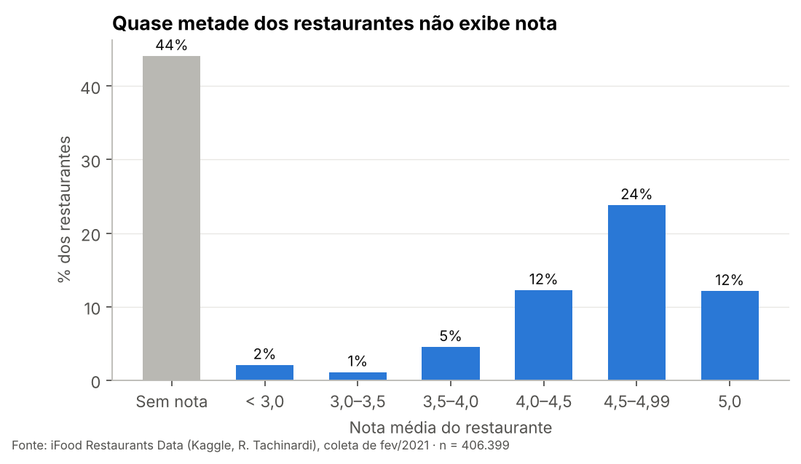
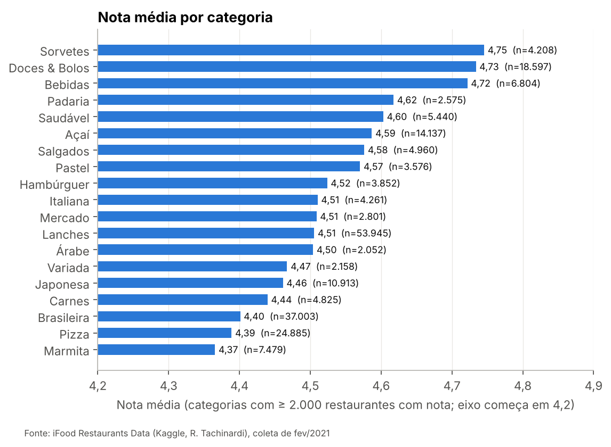
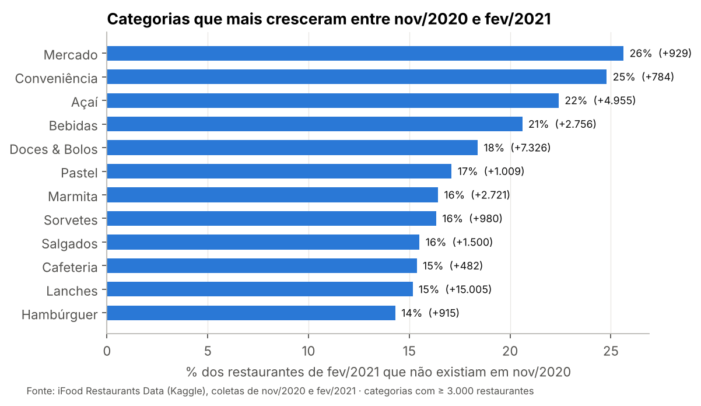
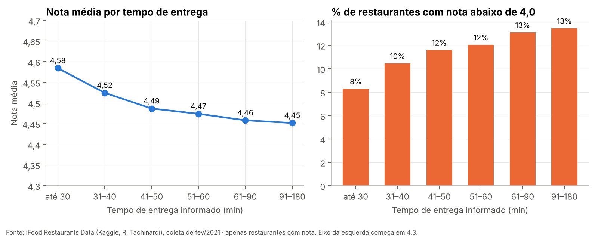
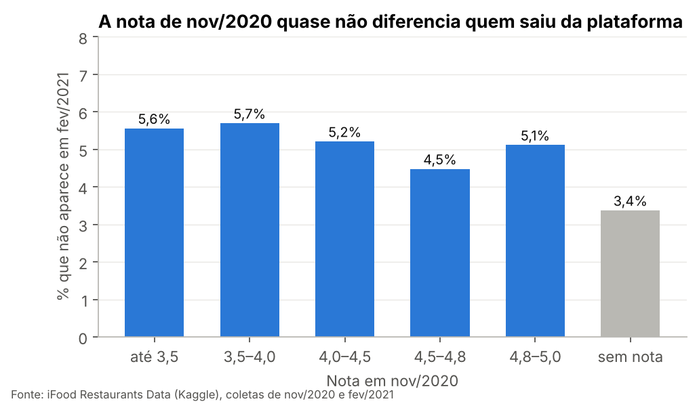

# 🔍 Análise de Dados – Restaurantes do iFood

Projeto em Python de **limpeza, análise exploratória e extração de insights** com dados públicos de cerca de **400 mil restaurantes do iFood**, coletados em nov/2020 e fev/2021.

**Perguntas centrais:** a nota de um restaurante diz o que parece dizer? O que se relaciona com ela? E como a plataforma mudou em três meses?

> **Dados:** [iFood Restaurants Data](https://www.kaggle.com/datasets/ricardotachinardi/ifood-restaurants-data), publicado no Kaggle por Ricardo Tachinardi. Cada linha é um restaurante, com nota média, tempo e taxa de entrega, distância, pedido mínimo, faixa de preço e categoria. A base **não tem comentários nem nota por pedido**. Os arquivos brutos (470 MB) não estão no repositório; veja [como baixar](#️-como-rodar).

---

## 📌 Principais insights



| # | Insight | Implicação |
|---|---|---|
| 1 | **44% dos restaurantes não exibem nota** (aparecem com nota 0). Tratar o zero como nota derruba a média de **4,51 para 2,52** | Separar "sem nota" de "nota baixa" é o primeiro passo de qualquer análise |
| 2 | As notas são **concentradas no topo**: mediana de 4,67, **22% com nota 5,0** e só 11% abaixo de 4,0 | A nota média diferencia pouco os restaurantes |
| 3 | Entrega mais lenta se associa a nota menor (**4,58** até 30 min → **4,45** acima de 90 min), mas o efeito é **pequeno** (Spearman −0,10) | O tempo importa, mas não explica a avaliação sozinho |
| 4 | **A categoria pesa mais que o tempo:** Sorvetes, Doces & Bolos e Bebidas ficam acima de **4,7**; Marmita, Pizza e Brasileira, perto de **4,4** | Comparar restaurantes dentro da mesma categoria |
| 5 | A base cresceu **12% em 3 meses** (+61 mil entradas, −16 mil saídas), puxada por **Mercado e Conveniência** (~25% da base delas era nova) e por **Açaí e Bebidas** | Expansão para além de refeições e efeito do verão |
| 6 | **A nota de nov/2020 não diferenciou quem saiu:** taxa de saída entre 4,5% e 5,7% em todas as faixas de nota | A saída de parceiros parece movida por outros fatores |

<table>
<tr>
<td></td>
<td></td>
</tr>
<tr>
<td></td>
<td></td>
</tr>
</table>

---

## 🧹 Limpeza de dados

A limpeza fica em `src/limpeza.py`, que registra o que cada etapa fez (`reports/qualidade_dados.csv`). Números da coleta de fev/2021:

| Problema encontrado | Linhas | Decisão |
|---|---:|---|
| Nota 0 (e quase nenhuma nota entre 0 e 1) | 179.157 (44%) | vira **"sem nota"**, não nota ruim |
| Tempo de entrega de −1 a 5.050 min | 255 | anulado fora de 5–180 min |
| Distância de até 11.810 km | 201 | anulada acima de 50 km |
| Pedido mínimo de R$ 99.999.999,99 | 59 | anulado acima de R$ 500 |
| Código IBGE do **ponto de busca**, não do restaurante | todas | cidade e UF extraídas da URL do restaurante |
| Faixa de preço em códigos (`CHEAPEST`…) | todas | traduzida e ordenada |

**Por que anular em vez de apagar a linha?** Um restaurante com tempo de entrega errado ainda tem nota e categoria válidas.

**Como saber que 0 é "sem nota"?** Além de quase não existirem notas entre 0 e 1, **34 mil restaurantes tinham nota em nov/2020 e aparecem com 0 em fev/2021**. O mais provável é que o app só mostre a nota quando há avaliações recentes suficientes.

---

## 🗂️ Estrutura

```
analise-restaurantes-ifood/
├── data/
│   ├── raw/          # CSVs do Kaggle (não versionados — ver abaixo)
│   └── processed/    # gerados por src/limpeza.py (não versionados)
├── notebooks/
│   └── analise_restaurantes_ifood.ipynb   # análise completa, narrada e executada
├── src/
│   ├── limpeza.py    # pipeline de limpeza + log de qualidade
│   └── analise.py    # gráficos e números-chave
├── figures/          # 6 gráficos
├── reports/
│   ├── qualidade_dados.csv
│   ├── insights.json            # todos os números citados aqui
│   ├── resumo_por_categoria.csv
│   └── resumo_por_uf.csv
└── requirements.txt
```

## ▶️ Como rodar

1. Baixe o dataset no [Kaggle](https://www.kaggle.com/datasets/ricardotachinardi/ifood-restaurants-data) (é preciso ter conta) e coloque os dois CSVs em `data/raw/`:
   - `ifood-restaurants-february-2021.csv`
   - `ifood-restaurants-november-2020.csv`
2. Rode:

```bash
pip install -r requirements.txt
python src/limpeza.py      # ~15 s
python src/analise.py      # gera figures/ e reports/
jupyter notebook notebooks/analise_restaurantes_ifood.ipynb
```

## 🛠️ Ferramentas

Python · pandas · Matplotlib · Jupyter

## ⚖️ Limitações

- **Nível restaurante, não pedido:** sem comentários, sem número de avaliações e sem nota por pedido.
- **Tempo e taxa de entrega são do ponto de busca** usado na coleta, não da entrega real.
- **Cobertura geográfica desigual:** Tocantins aparece com só 109 restaurantes, o que indica falha de cobertura.
- **Dados de 2020–2021**, durante a pandemia.
- **Correlação ≠ causalidade** em todos os cruzamentos.

## 📄 Créditos

Dados coletados e publicados por [Ricardo Tachinardi](https://www.kaggle.com/datasets/ricardotachinardi/ifood-restaurants-data) a partir do site público do iFood. O dataset não informa licença; por isso, os dados brutos não são redistribuídos aqui. Este projeto não tem vínculo com o iFood.

---

**Luiza Miller** · [LinkedIn](https://linkedin.com/in/luiza-miller) · [GitHub](https://github.com/Luizamiller)
