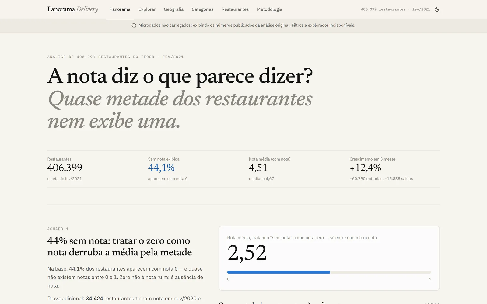
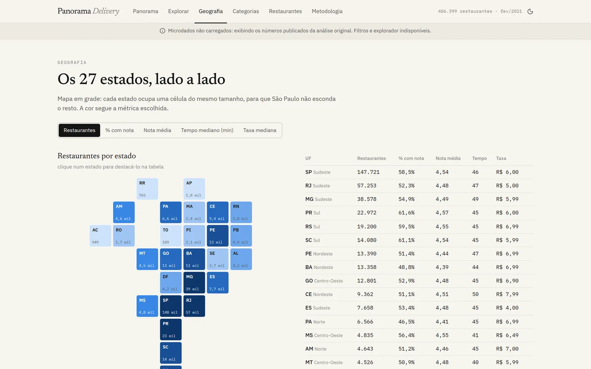
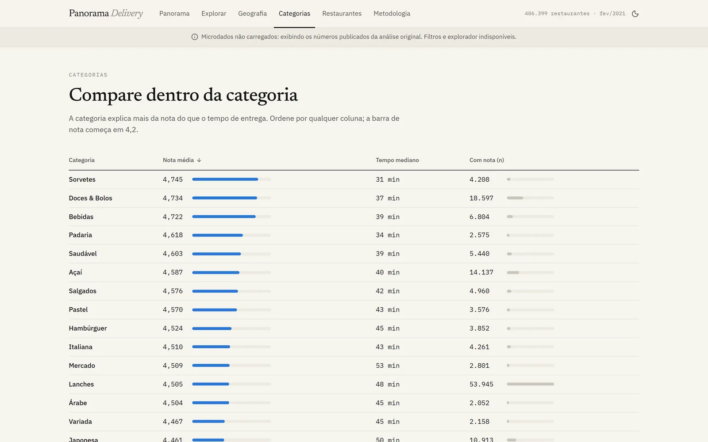
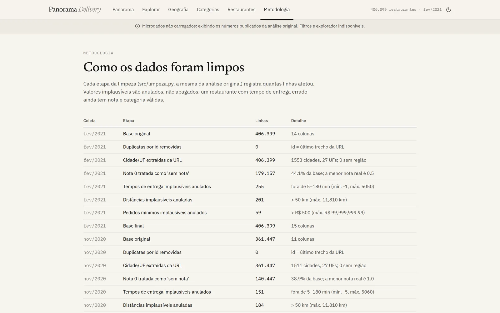
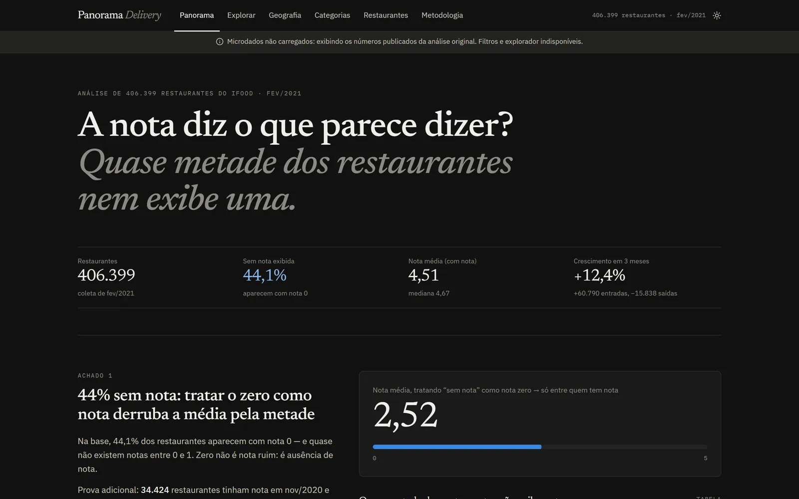

# Panorama Delivery — análise de 406 mil restaurantes do iFood

[](https://github.com/Luizamiller/analise-restaurantes-ifood/actions/workflows/testes.yml)

<p>
  <a href="https://luizamiller.github.io/analise-restaurantes-ifood/"></a>
  <a href="#como-rodar"></a>
</p>

**Acesso na demonstração:** Mostra os agregados publicados da análise (a base completa do Kaggle não vai para a web).

Análise de dados públicos de cerca de **400 mil restaurantes do iFood**, coletados em nov/2020 e fev/2021, agora com uma **plataforma interativa**: uma narrativa com os seis achados, um explorador com filtros recalculados sobre os microdados, um mapa por estado, um ranking de categorias e um explorador de registros.

**Perguntas centrais:** a nota de um restaurante diz o que parece dizer? O que se relaciona com ela? E como a plataforma mudou em três meses?

> **Dados:** [iFood Restaurants Data](https://www.kaggle.com/datasets/ricardotachinardi/ifood-restaurants-data), publicado no Kaggle por Ricardo Tachinardi. Cada linha é um restaurante, com nota média, tempo e taxa de entrega, distância, pedido mínimo, faixa de preço e categoria. A base **não tem comentários nem nota por pedido**. Os arquivos brutos (470 MB) não estão no repositório; veja [como rodar](#como-rodar). Projeto independente, sem vínculo com o iFood.




## Principais achados

| # | Achado | Implicação |
|---|---|---|
| 1 | **44% dos restaurantes não exibem nota** (aparecem com nota 0). Tratar o zero como nota derruba a média de **4,51 para 2,52** | Separar "sem nota" de "nota baixa" é o primeiro passo de qualquer análise |
| 2 | As notas são **concentradas no topo**: mediana de 4,67, **22% com nota 5,0** e só 11% abaixo de 4,0 | A nota média diferencia pouco os restaurantes |
| 3 | Entrega mais lenta se associa a nota menor (**4,58** até 30 min → **4,45** acima de 90 min), mas o efeito é **pequeno** (Spearman −0,10) | O tempo importa, mas não explica a avaliação sozinho |
| 4 | **A categoria pesa mais que o tempo:** Sorvetes, Doces & Bolos e Bebidas ficam acima de **4,7**; Marmita, Pizza e Brasileira, perto de **4,4** | Comparar restaurantes dentro da mesma categoria |
| 5 | A base cresceu **12% em 3 meses** (+61 mil entradas, −16 mil saídas), puxada por **Mercado e Conveniência** (~25% da base delas era nova) e por **Açaí e Bebidas** | Expansão para além de refeições e efeito do verão |
| 6 | **A nota de nov/2020 não diferenciou quem saiu:** taxa de saída entre 4,5% e 5,7% em todas as faixas de nota | A saída de parceiros parece movida por outros fatores |

O [notebook narrado](notebooks/analise_restaurantes_ifood.ipynb) continua executado e legível no GitHub.

## A plataforma

| Página | O que faz | Precisa dos microdados? |
|---|---|---|
| **Panorama** | Os seis achados em formato editorial, com gráficos interativos e tabela alternativa em cada figura | Não |
| **Explorar** | Filtros por coleta, UF, região, categoria, faixa de preço e frete; KPIs, distribuição, tempo × nota, categorias e preço recalculados | Sim |
| **Geografia** | Mapa em grade dos 27 estados (cada um com o mesmo tamanho) e tabela por métrica | Não, para fev/2021 sem filtros |
| **Categorias** | Ranking ordenável com nota, tempo mediano e tamanho de amostra | Não |
| **Restaurantes** | Explorador de registros com busca, ordenação e paginação no servidor | Sim |
| **Metodologia** | Log de qualidade da limpeza, decisões e as figuras originais | Não |

**Três fontes de dados, sempre explícitas na interface:**

- **completo** — a base real limpa, gerada a partir dos CSVs do Kaggle;
- **agregados** (padrão sem os CSVs) — os números publicados da análise original (`reports/`);
- **sintético** — uma amostra com o mesmo esquema, só para desenvolvimento, com aviso fixo de que os números não são reais.

## Arquitetura

```
CSV do Kaggle ─▶ src/limpeza.py (original) ─▶ Parquet ─▶ DuckDB ─▶ FastAPI ─▶ React
                                                │
                       src/analise.py ◀─────────┘  (figuras, insights.json e conferência dos números)
```

```
analise-restaurantes-ifood/
├── src/                 limpeza.py e analise.py — a análise original, sem mudanças de regra
├── notebooks/           notebook narrado e executado
├── reports/ figures/    números e gráficos publicados
├── backend/             FastAPI + DuckDB sobre Parquet
│   ├── pipeline/        build.py (CSV → Parquet com a limpeza original) e sintetica.py
│   ├── app/             consultas com as mesmas definições de src/analise.py
│   └── tests/           as consultas são conferidas contra as funções de src/analise.py
└── web/                 React 19 · TypeScript · Vite · Tailwind 4 · TanStack Query/Table · Motion · Lenis · GSAP
```

**Por que DuckDB e não Postgres:** é uma base analítica somente-leitura de ~770 mil linhas. DuckDB lê Parquet direto, agrega em dezenas de milissegundos e não exige servidor; um banco transacional não acrescentaria nada aqui.

**Por que gráficos em SVG próprios:** controle total da tipografia e das regras de leitura (eixo único, marcas finas, rótulos seletivos, tooltip em toda marca, tabela alternativa), sem o peso de uma biblioteca. A paleta (azul, laranja e cinza da análise original) foi validada para daltonismo e contraste nos modos claro e escuro.

**Movimento com propósito:** Lenis suaviza a rolagem só na página narrativa; GSAP com ScrollTrigger faz a média sair de 2,52 para 4,51 conforme a leitura avança; Motion revela as seções. Tudo respeita `prefers-reduced-motion`.

## Limpeza de dados

A limpeza fica em `src/limpeza.py`, que registra o que cada etapa fez (`reports/qualidade_dados.csv`). Números da coleta de fev/2021:

| Problema encontrado | Linhas | Decisão |
|---|---:|---|
| Nota 0 (e quase nenhuma nota entre 0 e 1) | 179.157 (44%) | vira **"sem nota"**, não nota ruim |
| Tempo de entrega de −1 a 5.050 min | 255 | anulado fora de 5–180 min |
| Distância de até 11.810 km | 201 | anulada acima de 50 km |
| Pedido mínimo de R$ 99.999.999,99 | 59 | anulado acima de R$ 500 |
| Código IBGE do **ponto de busca**, não do restaurante | todas | cidade e UF extraídas da URL do restaurante |
| Faixa de preço em códigos (`CHEAPEST`…) | todas | traduzida e ordenada |

**Por que anular em vez de apagar a linha?** Um restaurante com tempo de entrega errado ainda tem nota e categoria válidas.

**Como saber que 0 é "sem nota"?** Além de quase não existirem notas entre 0 e 1, **34 mil restaurantes tinham nota em nov/2020 e aparecem com 0 em fev/2021**. O mais provável é que o app só mostre a nota quando há avaliações recentes suficientes.

## Telas

**Geografia: os 27 estados lado a lado, com a métrica escolhida**



**Categorias: comparação dentro de cada categoria, ordenável por coluna**



**Metodologia: cada etapa da limpeza, com quantas linhas foram afetadas**



**Tema escuro**



## Demonstração online

<https://luizamiller.github.io/analise-restaurantes-ifood/> é um site estático no GitHub Pages, mas a lógica não foi reescrita: **o próprio backend FastAPI roda dentro do navegador**, no [Pyodide](https://pyodide.org) (Python em WebAssembly), num Web Worker. As chamadas a `/api` do frontend são desviadas para ele (`web/src/demo/`).

- Banco SQLite em memória, criado com os dados de exemplo a cada carregamento; recarregar a página volta tudo ao início.
- Sem servidor e sem chaves: o explorador de microdados precisa da base completa e fica indisponível.
- A primeira visita baixa o Python e as bibliotecas (alguns segundos); depois o navegador guarda em cache.
- Gerar de novo: `cd web && pnpm build:demo` (empacota o backend em `public/demo/backend.zip` e faz o build com a base do GitHub Pages).

## Como rodar

Pré-requisitos: Python 3.12 com [uv](https://docs.astral.sh/uv/) e Node 22 com pnpm.

**1. (Opcional, recomendado) base completa.** Baixe os dois CSVs do [Kaggle](https://www.kaggle.com/datasets/ricardotachinardi/ifood-restaurants-data) (é preciso ter conta) para `data/raw/`:
`ifood-restaurants-february-2021.csv` e `ifood-restaurants-november-2020.csv`. Depois:

```bash
cd backend
uv sync
uv run python -m pipeline.build        # limpeza original → data/processed/*.parquet (~20 s)
```

**2. API e interface.**

```bash
cd backend
uv run uvicorn app.main:app --port 8101
```

```bash
cd web
pnpm install
pnpm dev                                # http://localhost:5101
```

Sem o passo 1, a plataforma abre no modo **agregados**. Para desenvolver com filtros sem a base real: `uv run python -m pipeline.sintetica` e suba a API com `FONTE=sintetica`.

**Análise original** (gera `figures/` e `reports/` a partir de `data/processed/*.csv`, também criados pelo `pipeline.build`):

```bash
cd backend && uv run python ../src/analise.py
```

**Testes:**

```bash
cd backend && uv run python -m pipeline.sintetica && uv run pytest
cd web && pnpm typecheck && pnpm test && pnpm build
cd web && FONTE=sintetica PLAYWRIGHT_CHANNEL=msedge pnpm test:e2e
```

**Produção:** `docker compose up --build` (http://localhost:8000); monte `data/` com os Parquet para habilitar o modo completo.

## Limitações

- **Nível restaurante, não pedido:** sem comentários, sem número de avaliações e sem nota por pedido.
- **Tempo e taxa de entrega são do ponto de busca** usado na coleta, não da entrega real.
- **Cobertura geográfica desigual:** Tocantins aparece com só 109 restaurantes.
- **Dados de 2020–2021**, durante a pandemia.
- **Correlação ≠ causalidade** em todos os cruzamentos.
- A plataforma não foi validada visualmente com a base completa nesta reconstrução (os CSVs não estavam disponíveis); as consultas são conferidas contra `src/analise.py` na amostra sintética e o modo agregados usa os números publicados.

## Próximos passos

- Cruzar a nota com o **número de avaliações** (se uma nova coleta trouxer esse campo).
- Comparar restaurantes **dentro de cada categoria e cidade**, com um modelo simples (regressão) controlando tempo, preço e taxa.
- Uma coleta mais recente para ver se os padrões de 2020–2021 se mantêm fora da pandemia.

## Créditos

Dados coletados e publicados por [Ricardo Tachinardi](https://www.kaggle.com/datasets/ricardotachinardi/ifood-restaurants-data) a partir do site público do iFood. O dataset não informa licença; por isso, os dados brutos não são redistribuídos aqui.

---

**Luiza Miller** · [LinkedIn](https://linkedin.com/in/luiza-miller) · [GitHub](https://github.com/Luizamiller)

## Outros projetos

- **UMAMI** — app de delivery com sacola de até quatro lojas, entrega combinada e assistente que monta o pedido. [Demonstração](https://luizamiller.github.io/umami/) · [Código](https://github.com/Luizamiller/umami)
- **Às Sábias Reflexões** — acervo do podcast com IA: do vídeo à transcrição, 8 peças revisadas e assistente com citações. [Demonstração](https://luizamiller.github.io/sabias-reflexoes-ia/) · [Código](https://github.com/Luizamiller/sabias-reflexoes-ia)
- **Fale com o Farmacêutico** — atendimento farmacêutico no delivery, com IA que sugere e o farmacêutico que decide. [Demonstração](https://luizamiller.github.io/fale-com-farmaceutico/) · [Código](https://github.com/Luizamiller/fale-com-farmaceutico)
